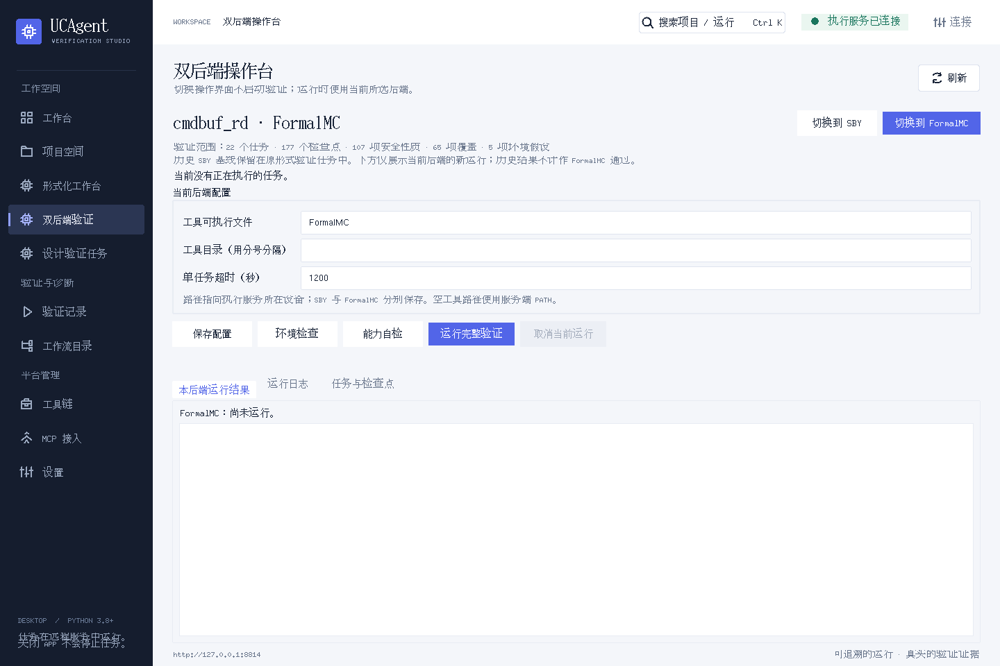

# UCAgent CMDBUF RD：RTL、形式验证与 Tk GUI

本仓库保存当前已对齐的 `cmdbuf_rd` 项目：9 项 CMDBUF/OTB、3 个 XAU、最老 5 条未成功发射命令窗口、三周期前向流水、MEM 成功发射后四拍返回，以及每个 XAU 保序的 RR 响应。

操作界面为 **Python Tkinter/ttk 原生 GUI**。在 UCAgent 已关联的 SBY 任务中点击“切换到 FormalMC”，即可进入完整项目的 FormalMC 操作页；两种后端独立保存配置和结果。HTML 文件是报告与文档。

## 目录

| 目录 | 内容 |
|---|---|
| `rtl/` | 当前三份 RTL，与封存验证包的 RTL 字节相同 |
| `formal/cmdbuf_rd_dual_backend/` | 可迁移的 SBY / FormalMC 验证包、22 个任务、177 个检查点与历史验证证据 |
| `ucagent-tool/` | 已更新的 UCAgent 桌面与服务完整源码，保留上游 Apache-2.0 许可证 |
| `gui/` | Tk 桌面 zipapp 和当前项目启动入口 |
| `docs/design/` | 详细设计方案与架构图 |
| `docs/timing/` | 已对齐时序图、5A / 6B / 10B 决策 |
| `docs/fault_catalog/` | 注错清单及容量保底场景 |
| `docs/gui/` | 15 张真实 Tk 截图、逐步操作说明和离线阅读版 |
| `simulation/` | 早期 RTL 仿真工程、独立参考模型与历史结果 |
| `verification/closure/` | 完整 UCAgent 流程报告与原始证据分卷 |
| `verification/gui/` | Tk GUI 回归日志、实际界面截图与验收记录 |
| `provenance/` | GUI 变更及交付来源说明 |

## 运行 SBY / FormalMC

在有对应工具的 Linux 设备上：

```sh
cd formal/cmdbuf_rd_dual_backend
python3 run.py --list
python3 run.py --backend sby --tool /your/oss-cad-suite/bin/sby --tool-dir /your/oss-cad-suite/bin --timeout 1200 --sby-timeout 900
python3 run.py --backend formalmc --tool /your/install/bin/FormalMC
```

FormalMC 入口沿用当前 UCAgent 支持的命令接口，并先执行能力自检。当前开发设备没有真实 FormalMC，因此未宣称已完成 FormalMC 实机证明。许可证及厂商环境由执行设备提供。

这是已验证版本的快照：形式任务使用 `jobs/` 中锁定的输入和模型。只修改顶层 `rtl/` 不会改变形式验证对象；迭代设计应重新生成任务输入并重新验证。

## 使用 Tk GUI

[详细操作图示](docs/gui/README.md)覆盖启动连接、一键切换 SBY / FormalMC、保存配置、运行验证、结果判断、日志排错及阶段工作台。下载后可打开 [带点击位置编号的阅读版](docs/gui/index.html)。

```sh
python3 gui/UCAgent-Desktop.pyz --server http://127.0.0.1:8814
```

执行服务需使用仓库内匹配的 UCAgent 源码，并登记 `formal/cmdbuf_rd_dual_backend` 的实际绝对路径。登记与迁移说明见 [Tk GUI 使用说明](docs/GitHub使用说明.md) 及 [服务登记格式](ucagent-tool/docs/content/02_usage/13_portable_formal_gui.md)。新设备可以从“**双后端验证**”入口打开登记项目；原 SBY 任务的一键导航需填入该设备的真实任务 ID。

`gui/Start-UCAgent-CMDBUF.pyw` 是本次原任务入口，默认连接本机 SSH 转发端口 18814。新设备使用上面的通用命令并填写自己的服务地址。仓库没有保存 SSH 密码、API token 或许可证。



## 已完成的实际验证

- 原 UCAgent 正式流程 14/14 阶段完成；规格拆分为 15 FG → 35 FC → 177 CK。
- 107 个安全检查点获得无界证明，65 个业务覆盖获得见证；5 个环境假设单列。
- 49 个代表注错变异检出并完成原版/故障版同输入回放。
- 可迁移入口原始 SBY 22/22 任务通过；FormalMC 规范化输入由 SBY 完成 22/22 交叉验证。
- Tk 桌面测试 82/82、服务及平台入口回归 39/39；实际 Tk 界面完成原 SBY 页一键切换及 SBY 单任务运行。
- FormalMC 实际环境检查记录工具缺失，没有将其显示为完整验证通过。

来源、范围及历史失败尝试见 [完整流程报告](verification/closure/verification_summary.md)、[可迁移验证包说明](formal/cmdbuf_rd_dual_backend/README.md) 和 [GUI 验收记录](verification/gui/validation_summary.json)。早期 `simulation/` 文档只描述当时的仿真阶段，完整形式验证结论以这些后续报告为准。

## 复核上传完整性与原始证据

```sh
python3 tools/verify_publication.py
python3 tools/assemble_evidence.py
tar -xzf verification/closure/cmdbuf_rd_evidence.tar.gz -C verification/closure
python3 verification/closure/evidence/verify_delivery_sha256.py verification/closure/evidence
```

完整原始证据包共 212,829,414 字节，因单文件大小限制分为 5 卷。重组后的 SHA256 必须为 `9cc646b2c13a659256b45d1b30a0cd82444ca6a7d8bcbe16a6cd9e9df4ccda00`。上传不重写原始签名、证明结果或封存输入。

本项目结论适用于已定义的初始复位事务域和输入输出约束；无条件最终完成、运行中 MEM 协同复位及物理时序签核不在已完成验证范围内。第三方工具运行时不随本仓库打包。
