# CMDBUF RD · Tk GUI 详细操作图示

本文对应仓库内已交付的 **UCAgent 原生 Tkinter/ttk 桌面界面**，操作图来自实际窗口。日期：2026-10-12。HTML 版本是阅读说明的页面；实际验证操作在 Tk 窗口中完成。

GitHub 可直接阅读本页。下载仓库后，打开同目录 [index.html](index.html)，可查看带点击位置编号的离线阅读版；点击截图可放大查看原始画面。

**重跑当前项目的操作顺序：打开桌面 → 连接执行服务 → 进入 cmdbuf_rd → 选择 SBY 或 FormalMC → 填写并保存配置 → 环境检查 → FormalMC 能力自检 → 运行完整验证 → 查看结果和日志。**

本次拍图只读取现有任务和运行记录，没有启动新的求解任务、修改服务配置或推进验收阶段。图中的 SBY 最新记录是历史 `quota_math` 单任务通过，FormalMC 最新记录是历史环境检查发现工具缺失。两者都不能当成本次完整验证通过。截图源代码和像素校验见 [拍图记录](capture_receipt.json)。

## 阅读导航

- [01 启动桌面与连接服务](#connect)
- [02 看懂主导航和两个项目入口](#navigation)
- [03 打开原 SBY 任务，一键进入 FormalMC](#original)
- [04 从“双后端验证”直接进入项目](#packages)
- [05 配置 SBY](#sby)
- [06 配置 FormalMC](#formalmc)
- [07 查看 22 个任务与 177 个检查点](#inventory)
- [08 执行环境检查、自检和完整验证](#execute)
- [09 读懂结果与运行日志](#results)
- [10 取消、退出和恢复](#recovery)
- [11 原 14 阶段工作台的按钮和页签](#stages)
- [12 新设计如何建立阶段任务](#new-design)
- [13 常见问题与截图中的能力提示](#faq)
- [14 截图和证据索引](#evidence)

<a id="connect"></a>

## 01 启动桌面与连接服务

### 1.1 当前电脑的入口

下载或克隆仓库后，进入 `gui/`。已经建立到本次虚拟机服务的 SSH 转发时，运行 `Start-UCAgent-CMDBUF.pyw`，会直接定位到原 SBY 阶段任务。

Windows 的 `.pyw` 需要安装带 Tk 的 Python 并正确关联。双击无窗口时，用 Python 显式启动：

```sh
python gui/Start-UCAgent-CMDBUF.pyw
```

如果电脑没有文件关联或想直接指定服务，使用通用入口：

```sh
python gui/UCAgent-Desktop.pyz --server http://127.0.0.1:18814
```

当前默认 `18814` 是 Windows 电脑的本地转发端口，转发到虚拟机的 `8814` 服务。可在终端保持以下连接：

```sh
ssh -N -L 18814:127.0.0.1:8814 root@192.168.31.116
```

登录使用已有 SSH 凭据，GUI 不要求填写 SSH 密码。终端关闭或电脑重启后，需要重新建立转发。

### 1.2 在其他设备启动

桌面客户端连接该设备实际可访问的 UCAgent 服务地址。若客户端和服务都在执行设备本机，可使用：

```sh
python3 gui/UCAgent-Desktop.pyz --server http://127.0.0.1:8814
```

Linux 桌面要提供 Tk 和图形显示环境。执行服务需使用配套的更新源码、登记完整验证包，并提供实际工具环境；具体登记见 [GitHub 使用说明](../GitHub使用说明.md) 和 [登记格式](../../ucagent-tool/docs/content/02_usage/13_portable_formal_gui.md)。

### 1.3 在窗口中连接

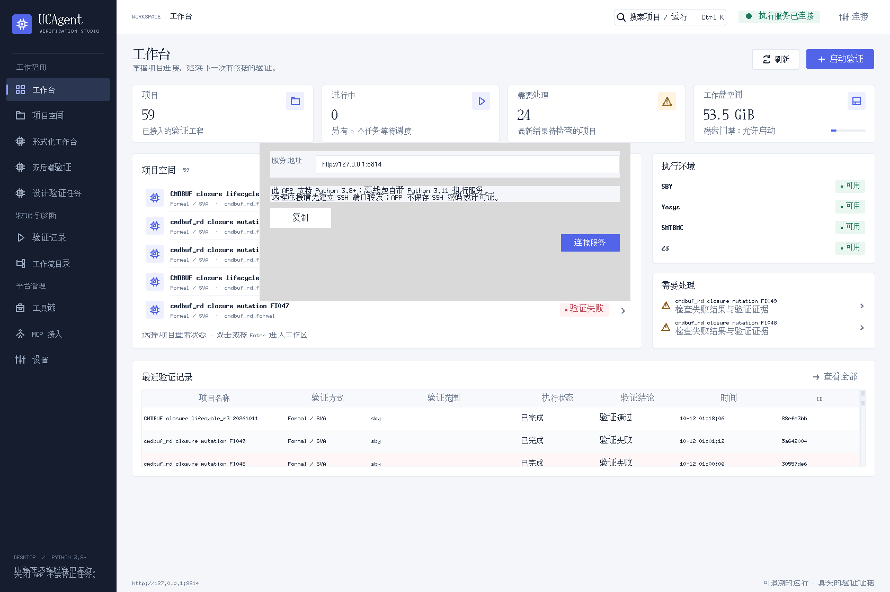

**操作位置：①窗口右上角“连接” → ②弹窗“服务地址” → ③“连接服务”。**

1. 输入能从客户端访问的 HTTP 服务地址。当前 Windows 电脑填写 `http://127.0.0.1:18814`。
2. 点击“连接服务”。
3. 确认右上角显示绿色 **“执行服务已连接”**。
4. 如果没有连接成功，先确认服务和 SSH 转发正常，再点击“刷新”或重新连接。

图 02 是在虚拟机本机拍摄，因此显示 `8814`；它不是 Windows 端必须照抄的地址。连接服务成功只表示可以读取平台，不能说明 SBY / FormalMC 工具或设计验证已经通过。

<a id="navigation"></a>

## 02 看懂主导航和两个项目入口

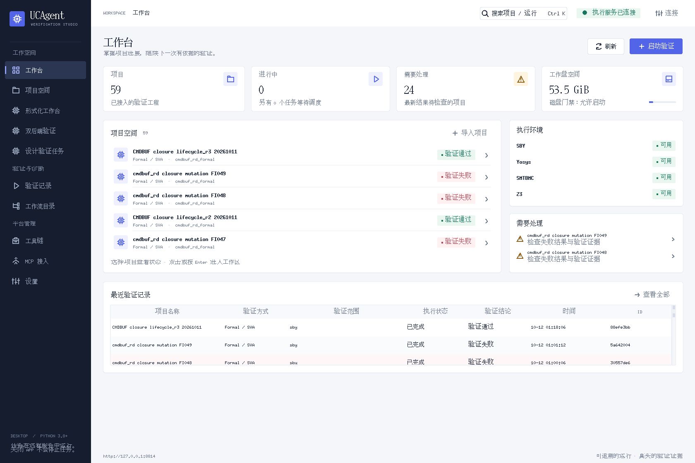

| 位置 | 用途 | 当前项目怎么使用 |
|---|---|---|
| 工作台 | 总览、项目、运行情况和工具状态 | 检查连接状态，了解是否有正在执行的任务 |
| 项目空间 | 管理已导入的 RTL / 验证工程 | 新设计先导入工程；当前 cmdbuf_rd 已经有正式任务 |
| **形式化工作台** | 原 UCAgent 阶段任务及 Check / Complete 流程 | 查看原 14 阶段、原验收结论和一键切换按钮 |
| **双后端验证** | 已登记完整验证包的 SBY / FormalMC 操作台 | 重跑当前封存项目的 22 个任务 |
| 验证记录 | 平台通用运行记录 | 根据项目名称和运行 ID 查历史记录 |
| 工具链 | 执行服务上的工具登记 | 新建设计任务时核对真实工具链 ID |
| 设置 / 顶部连接 | 当前客户端与服务配置 | 连接正确的执行服务 |

当前包的独立新运行主要在“**双后端操作台 → 本后端运行结果 / 运行日志**”查看；原阶段记录在“**形式化工作台**”查看。它们的证据格式与验收状态分别保留。

总览图中的 `FIxxx` 是注错工程。故障版产生“验证失败”可能正是注错检测的预期结果，应结合项目名称和注错报告判断，不能把它自动归为原版 cmdbuf_rd 的缺陷。

<a id="original"></a>

## 03 打开原 SBY 任务，一键进入 FormalMC

### 3.1 选择原任务

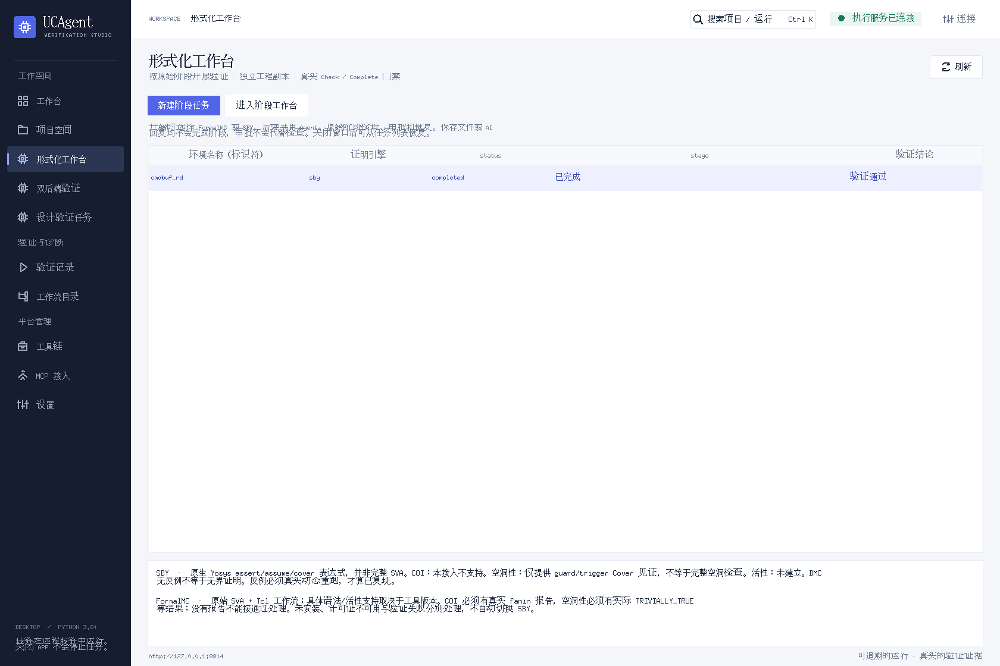

1. 点击左侧“**形式化工作台**”。
2. 在列表中选中 DUT 为 `cmdbuf_rd`、引擎为 `sby` 的原任务。
3. 双击该行，或点击“**进入阶段工作台**”。

本次原会话 ID 为 `90855753a21f4dc7a0dc29b7892e38f3`。新设备使用自己的任务 ID；仅复制源码和验证包不会自动复制这个会话数据库。

### 3.2 进入原验收页

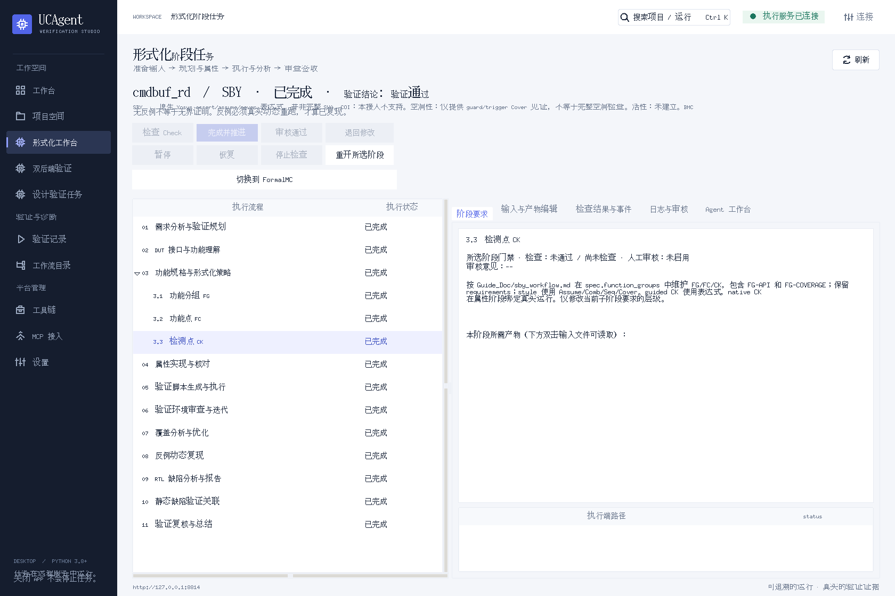

**识别顺序：①顶部 DUT / 引擎 / 结论 → ②左侧阶段树 → ③“切换到 FormalMC”。**

顶部应显示 `cmdbuf_rd / SBY`，当前原任务为“**已完成**”，验证结论为“**验证通过**”。左侧包含需求、FG、FC、CK、属性、环境、覆盖、回放及总结等原流程节点。

单击“**3.3 检测点 CK**”等节点，右侧“阶段要求”显示对应要求和产物路径。单击阶段只改变查看位置，不推进流程。已完成任务中的 Check / Complete 等按钮处于灰色是正常状态。

图 04 右侧的“所选阶段门禁”是选中节点的检查投影，截图中显示“尚未检查”；它与顶部整任务结论、左侧阶段完成状态不是同一个字段。审查历史结论时，继续查看图 05 的已存检查结果和正式验收报告，不能只凭其中一行判断全部证明完成。

点击“**切换到 FormalMC**”，会直接进入下图的 FormalMC 操作台。

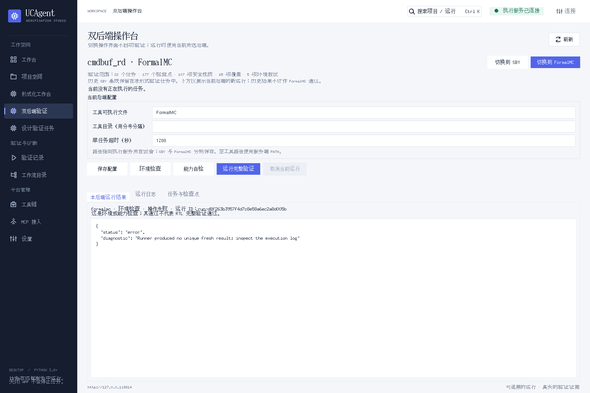

这一点击只切换操作界面。它不启动 FormalMC、不改写原 SBY 结论，也不将原 SBY 结果算成 FormalMC 通过。

<a id="packages"></a>

## 04 从“双后端验证”直接进入项目

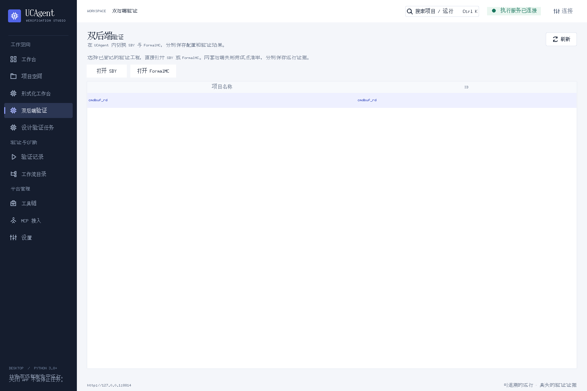

**操作位置：①左侧“双后端验证” → ②选中 `cmdbuf_rd` → ③“打开 SBY”或“打开 FormalMC”。**

新设备没有原 SBY 会话时，只要执行服务已经登记完整验证包，就可以使用这个入口。它不要求先建立或完成一个新的 14 阶段任务。

如果列表为空，执行服务尚未登记包或客户端连接了另一台服务。管理员需在登记文件中填写 `formal/cmdbuf_rd_dual_backend` 的本机绝对路径，再按 [服务登记格式](../../ucagent-tool/docs/content/02_usage/13_portable_formal_gui.md)启动匹配版本的服务。

<a id="sby"></a>

## 05 配置 SBY

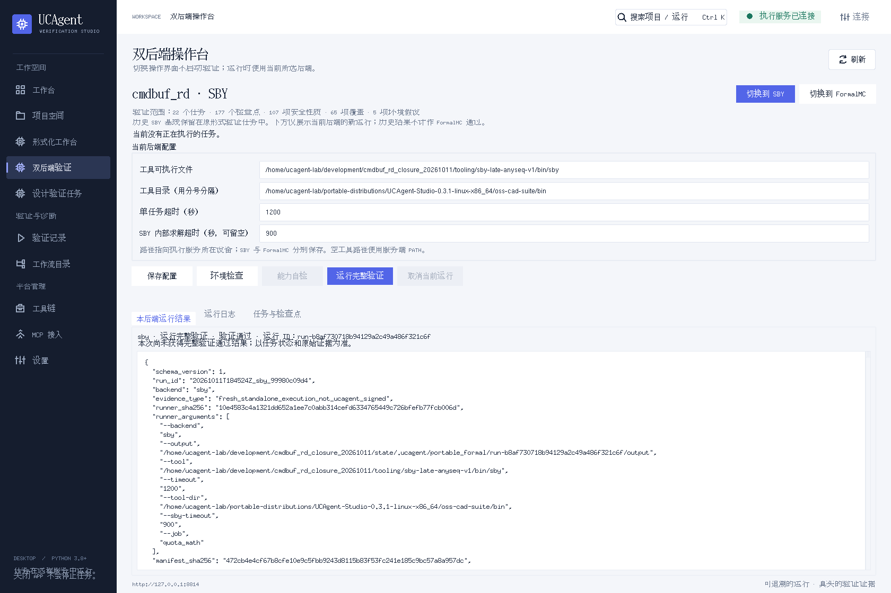

确认标题是 **`cmdbuf_rd · SBY`**，右上角 SBY 按钮为选中状态。以下路径均指向**执行服务所在设备**，不是 Windows 客户端。

| 字段 | 怎么填 | 示例 / 本次值 |
|---|---|---|
| 工具可执行文件 | 填 `sby` 的实际文件路径；填命令名时需能在服务进程 PATH 中找到 | 新设备示例 `/opt/oss-cad-suite/bin/sby` |
| 工具目录（用分号分隔） | 提供 Yosys、SMTBMC 及所需求解器的目录；多个目录用英文 `;` 分隔 | `/opt/oss-cad-suite/bin;/opt/solvers/bin` |
| 单任务超时（秒） | 一个任务的外部等待预算，不是全部 22 任务的总时间 | 本次配置 `1200` |
| SBY 内部求解超时（秒，可留空） | SBY 自身的求解预算；留空使用任务原配置 | 本次配置 `900` |

截图中的 `/home/ucagent-lab/...` 是本次虚拟机的实际安装路径。其他设备应填写自己的路径，不直接照搬。

1. 填写或调整字段。
2. 点击“**保存配置**”，等待“已保存 sby 配置”提示。
3. 点击“**环境检查**”。
4. 环境检查通过后，点击“**运行完整验证**”。

SBY 的“**能力自检**”按钮在当前界面中为灰色；该按钮提供给 FormalMC 使用。正常重跑当前 SBY 项目不需要点击它。

配置变更后没有保存，启动会显示下图的提示，不会提交检查或验证任务：

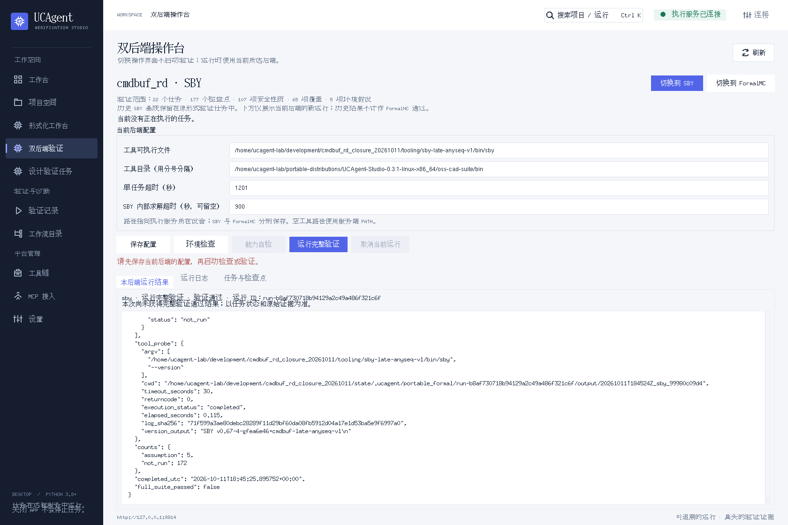

图中为拍图临时把超时从 `1200` 改为 `1201` 产生的真实客户端提示，随后已恢复原值，没有修改服务配置。编辑草稿可以在同一操作台来回切换后端时保留；需要长期保存时必须点击“保存配置”。

<a id="formalmc"></a>

## 06 配置 FormalMC


1. 点击右上角“**切换到 FormalMC**”。
2. 确认标题变为 **`cmdbuf_rd · FormalMC`**。
3. 填写执行设备实际安装的 FormalMC 可执行文件，例如 `/opt/formalmc/bin/FormalMC`。这只是路径格式示例，不表示该文件在当前机器上存在。
4. 如厂商工具依赖额外目录，在“工具目录”填写对应目录；许可证和厂商初始化环境由服务进程所在设备提供。
5. 设置单任务超时，点击“**保存配置**”。
6. 先做“**环境检查**”，再做“**能力自检**”；通过后点击“**运行完整验证**”。

FormalMC 模式没有 SBY 内部超时字段。SBY 和 FormalMC 分别保存工具路径、超时和运行结果；切回 SBY 后，其配置仍是 SBY 配置。

**能力自检**使用运行包内的小模型检查工具是否支持所需初始状态、符号输入、覆盖目标和故意失败的断言。自检通过只证明运行入口满足这些检查，不表示 cmdbuf_rd 已证明。完整 FormalMC 运行也会自动执行这项自检。

当前虚拟机未安装真实 FormalMC，工具缺失截图见 [第 09 节](#results)。未发现工具时，应在实际有工具和许可证的执行设备上配置并重新运行。

<a id="inventory"></a>

## 07 查看 22 个任务与 177 个检查点

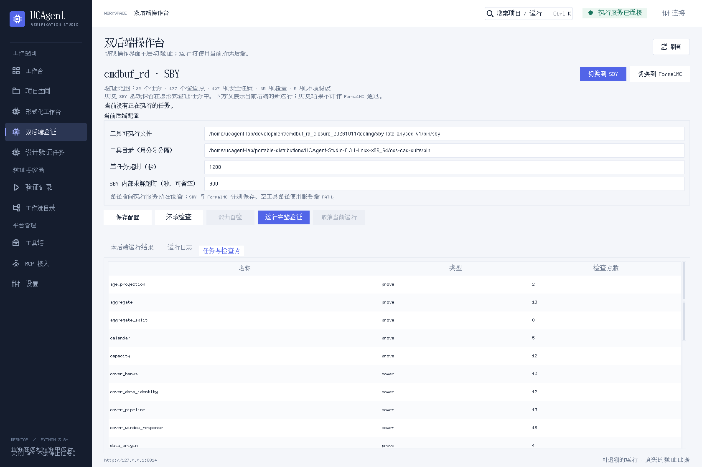

点击下方“**任务与检查点**”页签，核对顶部范围：

| 项目 | 当前封存包 |
|---|---:|
| 任务总数 | 22 |
| 规格检查点 CK | 177 |
| 安全检查点 | 107 |
| 业务覆盖检查点 | 65 |
| 环境假设 | 5 |

表格显示任务 ID、证明 / 覆盖模式和关联的 CK 数量；向下滚动可查看剩余任务。数学供应证明、辅助不变量等任务可能关联 0 个直接 CK，这不表示它们没有参与依赖证明。

完整测试点分解是 **15 FG → 35 FC → 177 CK**，见 [规格分解](../../formal/cmdbuf_rd_dual_backend/spec_catalog.md) 和 [机器可读清单](../../formal/cmdbuf_rd_dual_backend/spec_catalog.json)。该页是任务清单，不是逐 CK 的编辑器；逐项定义和运行结果在规格文件及结果 JSON 中查看。

当前项目的“运行完整验证”会提交全套任务，运行器按真实依赖关系安排供应证明和依赖任务。只修改仓库顶层 `rtl/` 不会更新封存包的 `jobs/` 输入；设计变更后需重新生成输入并重新验证。

<a id="execute"></a>

## 08 执行环境检查、自检和完整验证

### 8.1 按钮的准确含义

| 按钮 | 实际操作 | 何时使用 |
|---|---|---|
| 保存配置 | 保存当前后端工具路径和超时 | 修改字段后先执行 |
| 环境检查 | 检查运行包完整性和对应工具能否启动 | 第一次连接新设备、修改路径或工具环境后 |
| 能力自检 | 执行 FormalMC 兼容性小模型 | FormalMC 环境检查通过后 |
| **运行完整验证** | 用当前后端执行 cmdbuf_rd 全套任务 | 配置和工具条件就绪后 |
| 取消当前运行 | 请求停止该项目真正处于活动状态的运行 | 需要停止当前求解时 |

### 8.2 完整运行的实际步骤

1. 确认标题和后端正确。
2. 核对范围为 **22 个任务 / 177 个检查点**。
3. 修改配置后点击“保存配置”。
4. 点击“环境检查”，到“运行日志”查看实际输出。
5. FormalMC 再执行“能力自检”。
6. 点击“运行完整验证”一次。
7. 观察“正在执行”提示，记录项目、后端、动作与运行 ID。
8. 在“本后端运行结果”和“运行日志”查看进度与最终结果。

运行中可以切换 SBY / FormalMC 页面；已经启动的任务继续使用启动时的后端。切换页面不会把正在运行的 SBY 改成 FormalMC，也不会启动第二个任务。活动任务存在时，保存和新启动按钮受控；服务同时只接受一个新的活动运行。

环境检查、能力自检及完整运行都有各自的运行记录。当前操作台主要展示当前后端的最近一次记录；“刷新”或 `F5` 重新读取实际状态，不会重新求解。

<a id="results"></a>

## 09 读懂结果与运行日志

### 9.1 结果页：先看运行范围，再看通过状态

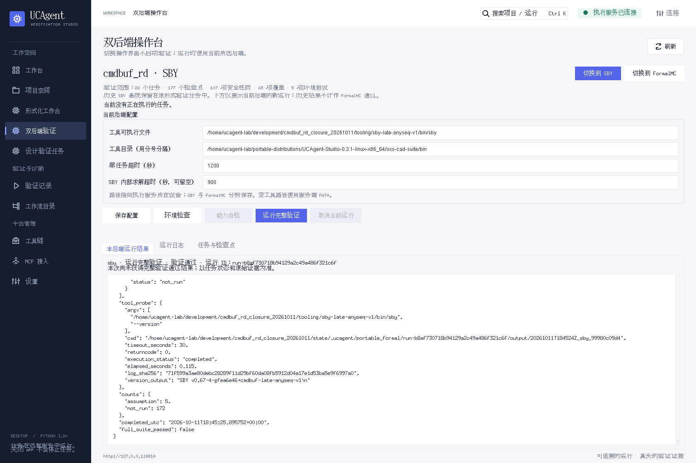

图 11 是真实的 `quota_math` 单任务运行。它的工具求解通过，但 **`full_suite_passed` 为 `false`**，所以正文明确提示“本次尚未获得完整验证通过结果”。这个运行仅验证辅助数学任务，结果里其余 172 个规格检测点为未运行，5 个环境假设单列。

结果第一行的“运行完整验证”是动作名称，**不能只凭该名称或“验证通过”文字判断全套完成**。应同时核对结果中的范围和完整套件标记。

| 看到的结果 | 应如何理解 |
|---|---|
| 环境检查通过 | 包和工具启动检查通过，尚未证明 DUT |
| 能力自检通过 | 运行入口的兼容性检查通过，尚未证明 DUT |
| 单任务 `passed`，`full_suite_passed=false` | 本次是部分运行，不是全套通过 |
| 正文显示“本次完整验证通过”，结果 `full_suite_passed=true` | 当前后端的全套运行满足检查点和依赖要求 |
| `error` / 工具缺失 / 许可证错误 | 执行条件或工具发生错误，不能当作 DUT 证明通过 |
| `timeout` / `cancelled` / 未识别结果 | 本次没有获得完整证明结论 |
| 安全性质失败并有反例 | 检查具体性质、假设和波形；动态重跑确认问题 |

全套通过时核对当前后端、22 任务的运行范围和 **107 安全已证明 / 65 覆盖已命中 / 5 假设单列**。环境假设不计为证明成功数量。

### 9.2 日志页：查看真实工具输出

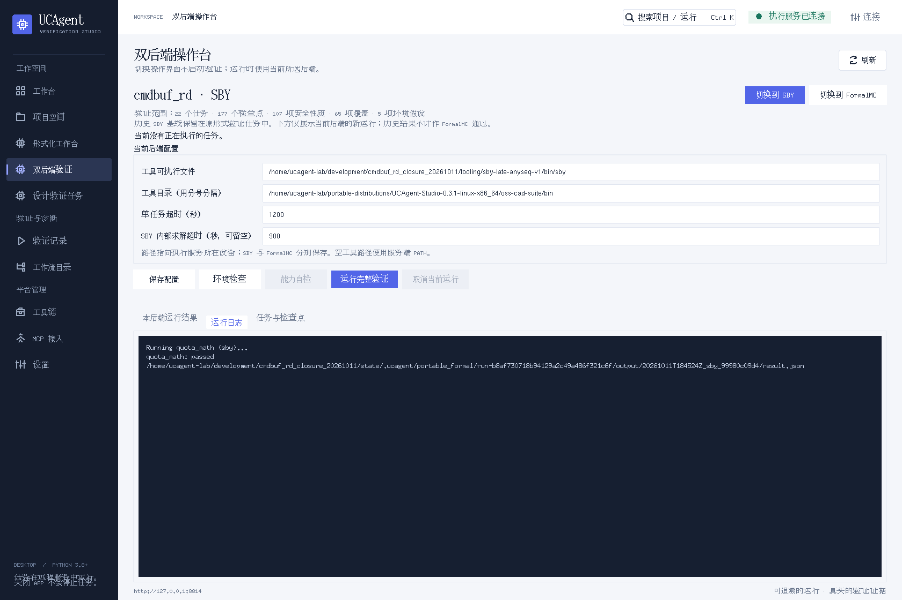

点击“**运行日志**”。这里保留真实命令、工具诊断、求解输出和退出情况。右侧滚动条用于查看前后内容。排查时记录运行 ID、后端、任务 ID、错误文字及相关日志，不只截图一个 PASS / FAIL。

操作台屏幕上的原始结果内容可以滚动查看。完整证据文件保存在执行服务状态目录下；需要复制完整目录时，在执行设备按实际工作空间和运行 ID 找到对应文件。当前界面没有为完整包提供一个“导出全部证据”的按钮。

### 9.3 FormalMC 工具缺失示例

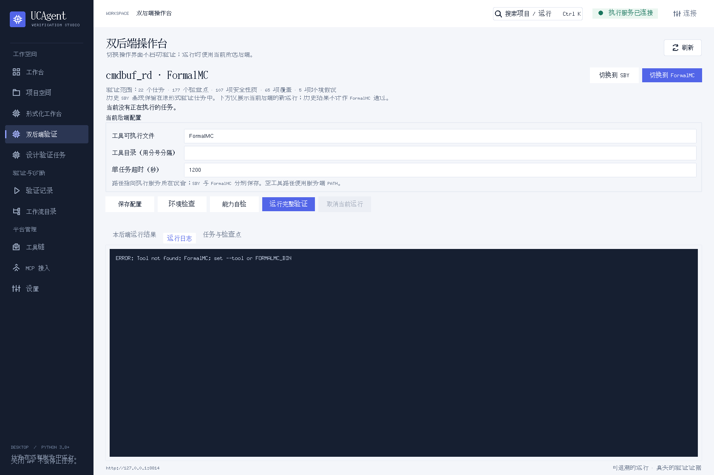

日志中的 `Tool not found: FormalMC` 表示执行服务没有找到指定工具。按以下顺序排查：

1. 工具文件是否存在于执行设备。
2. “工具可执行文件”是否填写正确，并已保存。
3. 服务用户是否有执行权限、所需 PATH / 动态库和厂商环境。
4. 工具能够启动后，再排查许可证或编译问题。

这张图不是 FormalMC 发现 RTL 错误的反例。本次原 SBY 已验收的结果也不会因此变成 FormalMC 通过。

<a id="recovery"></a>

## 10 取消、退出和恢复

“**取消当前运行**”没有任务时为灰色，如图 09。该项目有活动任务时可以点击，等待状态从取消请求转为最终取消，再查看日志。

如果运行 SBY 后切到 FormalMC 页面，取消按钮仍针对该项目实际运行中的 SBY 任务；先看“正在执行”提示中的后端和运行 ID。若活动运行属于另一个登记项目，当前项目的取消入口不会控制它。

当前入口连接远程执行服务，关闭 Tk 客户端不会停止远程服务。重新打开客户端并连接同一服务、同一包，可以读取服务保存的配置和运行结果。客户端未保存草稿不保证在退出后恢复，重要配置先点击保存。

电脑重启后，重新建立 SSH 转发，再打开桌面。原 SBY 阶段会话和新运行结果保存在服务端；本机 `.pyw` 文件并不包含完整远程数据库。如果用 UCAgent 的本机服务模式，退出行为应以该模式窗口的实际提示为准。

<a id="stages"></a>

## 11 原 14 阶段工作台的按钮和页签

### 11.1 查看原阶段结果

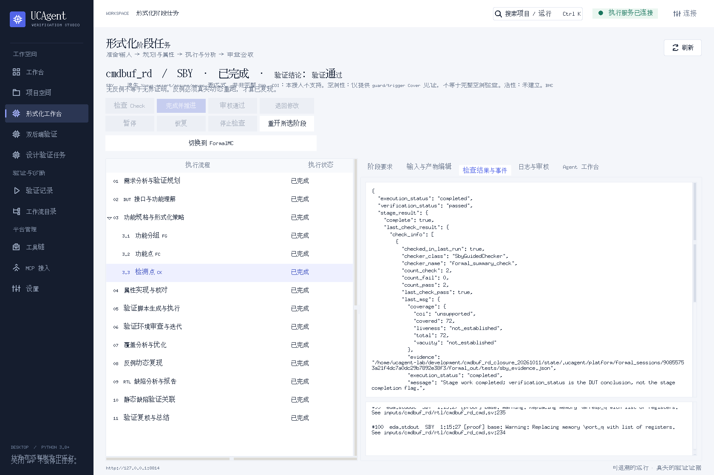

| 页签 | 用途 |
|---|---|
| 阶段要求 | 查看选中阶段的要求、参考文件、产物路径和门禁信息 |
| 输入与产物编辑 | 查看工作空间文件；允许编辑的文件提交前审查差异 |
| **检查结果与事件** | 查看执行状态、验证结论、实际检查结果和事件 |
| 日志与审核 | 保存阶段日志、填写审核理由、处理实际人工门禁 |
| Agent 工作台 | 让已配置的 Agent 准备当前阶段产物并调用原检查流程 |

阶段树会将分组与子节点展开显示。例如 FG / FC / CK 属于规格分解部分，屏幕上的顶层编号不等于原子阶段总数。当前验收记录确认 **14 个启用阶段全部完成**，以正式阶段记录为准。

### 11.2 按钮怎么用

| 按钮 | 含义 | 原已完成任务 |
|---|---|---|
| 检查 Check | 实际执行当前阶段检查 | 通常灰色，不需要为查看结果重新点击 |
| 完成并推进 | 满足门禁后完成阶段并进入下一阶段 | 当前已完成 |
| 审核通过 / 退回修改 | 处理确实启用的人工审核门禁 | 依据当前阶段和审核状态启用 |
| 暂停 / 恢复 | 处理阶段任务的暂停与恢复 | 依据实际状态启用 |
| 停止检查 | 停止阶段工作台当前活动检查 | 不等于双后端包的取消按钮 |
| 重新开启所选阶段 | 让既有任务重新进入阶段工作 | 查看历史结果或重跑封存包时无需点击 |
| 切换到 FormalMC | 当前 cmdbuf_rd 的完整包导航入口 | 可用；只切换页面 |

审核通过不能替代 Check，保存文件和 Agent 回复也不会自动完成阶段。已完成任务的灰色按钮反映真实状态，不表示 GUI 失效。

### 11.3 Agent 工作台

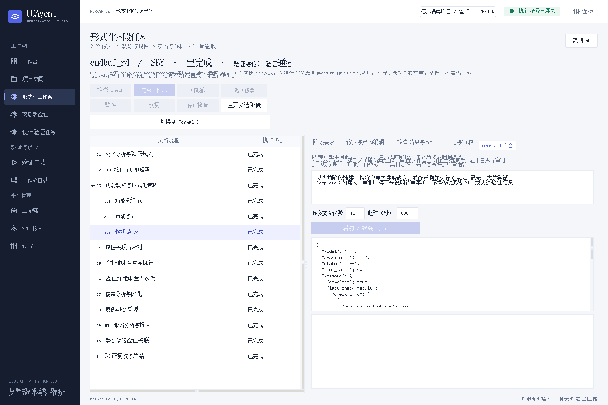

新建的阶段任务需要使用 Agent 时，在该页填写任务说明、运行轮数与时间预算，再使用“启动 / 继续 Agent”。执行服务应已配置适用的 Agent 身份和模型入口；本仓库的 Tk 客户端本身不提供模型凭据。

遇到人工审核门禁，先审查“输入与产物编辑”的差异和“检查结果与事件”，再在“日志与审核”填写实际理由并审核，通过后继续。当前原任务已完成，Agent 操作不作为重跑 22 任务的必要步骤。

<a id="new-design"></a>

## 12 新设计如何建立阶段任务

当前封存 cmdbuf_rd 的重跑入口已经在第 04～08 节说明。需要对新设计建立规格、测试点和属性时，使用原阶段流程：

1. 在“项目空间”导入执行设备上的真实工程，核对顶层和源码路径。
2. 在“工具链”核对可用的引擎和工具链 ID。
3. 进入“形式化工作台”，点击“新建阶段任务”。
4. 在下图表单中填写自己的项目、DUT、引擎及对应工具链。
5. 按工作要求设置人工审核、动态反例复现和静态缺陷关联选项，再提交。
6. 进入阶段工作台，按实际阶段要求准备产物、执行 Check / Complete，并处理审核门禁。

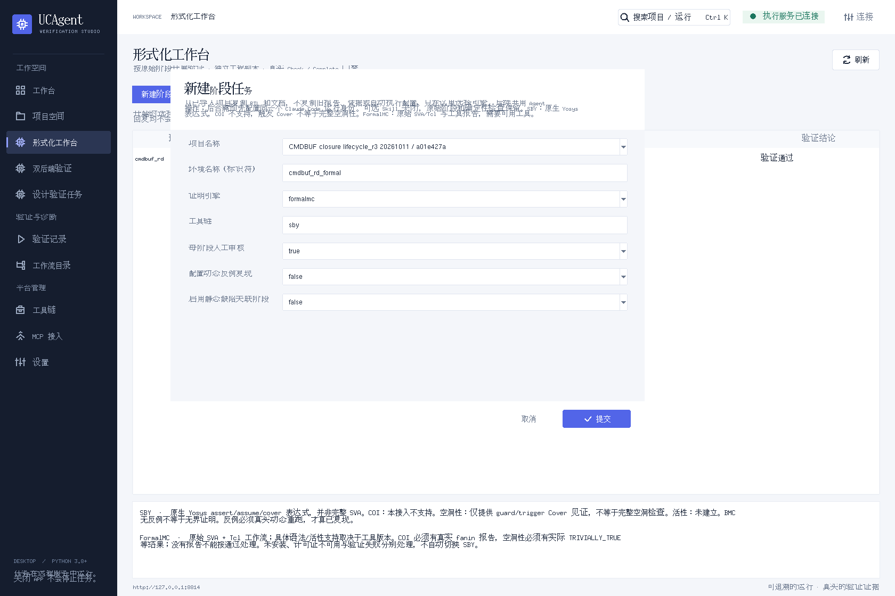

| 字段 | 操作要点 |
|---|---|
| 项目名称 | 选择已导入的目标设计，不能照抄截图里作为示例的辅助证明项目 |
| 环境名称（标识符） | 当前界面对 DUT 名称字段的标签；填写目标 DUT 的实际顶层模块标识符 |
| 证明引擎 | 选择 `sby` 或 `formalmc` |
| 工具链 | 填写该引擎在执行服务中真实登记的工具链 ID |
| 每阶段人工审核 | `true` 启用真实人工门禁，`false` 按检查器流程推进 |
| 配套动态反例复现 | 根据项目所需的动态回放环境配置 |
| 启用静态缺陷关联阶段 | 根据项目的静态检查能力配置 |

图 15 保留了窗口原始默认值，仅用于识别字段，拍图没有提交新任务。默认引擎和工具链文字并不保证成对可运行：创建 SBY 任务时选择 `sby` 和其实际工具链；创建 FormalMC 任务时选择 `formalmc` 和已登记的对应工具链。新任务不会自动继承旧报告和已通过的结论。

<a id="faq"></a>

## 13 常见问题与截图中的能力提示

| 现象 | 处理方法 |
|---|---|
| 双击 `.pyw` 无窗口 | 用 Python 显式启动；核对 Tk 安装、文件关联及服务地址 |
| 服务连接不上 | 核对服务进程、端口、客户端地址和 SSH 转发；先连通再刷新 |
| “双后端验证”列表为空 | 核对是否连接正确服务，以及完整包登记文件是否生效 |
| 原页没有当前包的“切换到 FormalMC”入口 | 核对客户端和服务版本，以及登记文件中的包与真实会话 ID 关联 |
| 修改配置后检查没有启动 | 先保存配置，再执行环境检查或完整验证 |
| SBY 的能力自检按钮灰色 | 正常；该自检按钮用于 FormalMC |
| 完整运行启动按钮灰色 | 检查是否有活动任务、请求是否还在处理、项目数据是否已加载 |
| `Tool not found` | 填写执行设备真实工具路径，保存后重新环境检查 |
| 许可证不可用 | 在执行服务设备上配置实际许可证环境，再检查日志 |
| 配置冲突 / revision 变化 | 刷新实际服务状态，核对自己的配置后再保存，不连续盲目重试 |
| 界面出现 `passed` 但还提示未完整通过 | 核对动作是否环境检查 / 自检 / 单任务，查看 `full_suite_passed` |
| 有求解超时 | 检查任务和日志；必要时调整外部与 SBY 内部预算，再发起新的运行 |

### 原 SBY 页的能力说明是什么意思

| 提示 | 含义 |
|---|---|
| 原生 Yosys assert / assume / cover，并非完整 SVA | 当前前端使用其支持的语法；时序规则可以用监视器、历史状态和断言表达 |
| COI 本接入不支持 | 当前没有提供完整的性质到 RTL 影响锥报告 |
| guard / trigger Cover 不等于完整空洞性 | 触发条件可达不等于所有断言都已做完语义空洞性分析 |
| 活性未建立 | 当前没有建立在无限等待环境下每个请求最终完成的证明 |
| BMC 无反例不等于无界证明 | 有限深度没有失败输入，不能当成所有时间范围的安全证明 |
| 反例必须真实动态重跑 | 工具得到失败输入后，实际回放确认问题，才记为已复现 |

这些是当前接入和项目范围的提示，不是某条新断言报错。当前原任务验收为 107 安全检查点无界证明、65 覆盖、5 环境假设单列和 49 类代表注错回放；没有声称完整 COI、全面空洞性或无限背压下的无条件最终完成。详见 [正式验收报告](../../verification/closure/verification_summary.md)。

<a id="evidence"></a>

## 14 截图和证据索引

| 图号 | 实际画面 | 本次是否执行验证 |
|---|---|---|
| 01 | 总览和主导航 | 否 |
| 02 | 服务连接弹窗 | 否，仅查看 |
| 03 | 原 SBY 阶段任务列表 | 否 |
| 04 | 原阶段树和一键入口 | 否，仅选择 CK 阶段查看 |
| 05 | 原任务检查结果与事件 | 否，读取既有验收 |
| 06 | 原任务 Agent 工作台 | 否，未启动 Agent |
| 07 | FormalMC 配置与操作台 | 否，读取既有记录 |
| 08 | 已登记完整验证包列表 | 否 |
| 09 | SBY 配置和操作按钮 | 否 |
| 10 | 22 任务清单 | 否 |
| 11 | 历史 SBY `quota_math` 单任务结果 | 否，读取既有运行 |
| 12 | 上述单任务真实日志 | 否，读取既有运行 |
| 13 | 未保存配置提示 | 否，仅客户端临时草稿，已恢复 |
| 14 | 历史 FormalMC 缺工具日志 | 否，读取既有运行 |
| 15 | 新阶段任务表单 | 否，未提交 |

全部截图在独立虚拟显示中使用实际 Tk 应用和实际执行服务拍摄，PNG 转码保持原始像素、尺寸和颜色。离线 HTML 阅读版的编号和框线是文档叠加层，不修改截图，也不是 GUI 新增按钮。

相应源码为仓库中的 `ucagent-tool/desktop/ucagent_tk/`；[拍图记录](capture_receipt.json)保存了源码哈希、截图哈希、GET 操作和前后状态检查。本次拍图确认原会话、包配置及运行记录均未改变。

完整验证输入与运行方法见 [验证包 README](../../formal/cmdbuf_rd_dual_backend/README.md)。原始证据归档的完整重组与校验见 [仓库首页](../../README.md#复核上传完整性与原始证据)。
